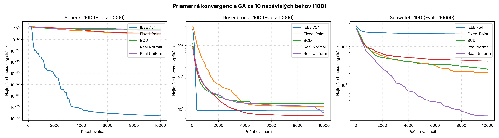

# Genetický algoritmus pre reálne parametre

Implementácia genetického algoritmu s elitizmom, pozičnou (rank) selekciou a jednobodovým krížením. Porovnávame päť variantov: tri binárne kódovania reálnych čísel (IEEE 754, Fixed-Point, BCD) a dva reálne GA (normálna a rovnomerná mutácia). Testované sú na funkciách Sphere, Rosenbrock a Schwefel.

## Varianty

| Variant | Reprezentácia | Mutácia |
|---|---|---|
| IEEE 754 | 32 bitov na dimenziu (znamienko, exponent, mantisa), hodnoty mimo intervalu sa orežú | bitová, 1 % |
| Fixed-Point | 32 bitov: 1 bit znamienko, pevný počet bitov pre celú a desatinnú časť (Sphere 3 + 28, Rosenbrock 2 + 29, Schwefel 9 + 22) | bitová, 1 % |
| BCD | 32 bitov = 8 desiatkových číslic (4 bity na číslicu), mapované na interval | bitová, 1 % |
| Real Normal | reálny vektor | x + N(0, σ²) s pravdepodobnosťou mut_rate |
| Real Uniform | reálny vektor | nová náhodná hodnota z celého rozsahu, mut_rate = 0,1 |

## Testované funkcie

| Funkcia | Rozsah | Optimum |
|---|---|---|
| Sphere | [-5,12; 5,12] | 0 |
| Rosenbrock | [-2,048; 2,048] | 0 |
| Schwefel | [-500; 500] | 0 |

## Nastavenie experimentu

Každá kombinácia funkcie a variantu bola spustená 10-krát v 10 dimenziách. Limit bol 10 000 vyhodnotení účelovej funkcie. Použitý bol rank výber, pravdepodobnosť kríženia 90 %, elitizmus 15 % a veľkosť populácie 50. Náhodné semeno: 42.

Parametre Real Normal (σ ako zlomok rozsahu a pravdepodobnosť mutácie) boli vyladené pre každú funkciu zvlášť, mriežkou σ ∈ {1 %, 5 %, 20 %} × mut_rate ∈ {0,05; 0,1; 0,3}, priemer z 5 behov:

| Funkcia | Vybrané σ | Vybraná mut_rate |
|---|---|---|
| Sphere | 1 % rozsahu | 0,05 |
| Rosenbrock | 1 % rozsahu | 0,10 |
| Schwefel | 5 % rozsahu | 0,30 |

## Výsledky

### Sphere (10D)

| Variant | Najlepší | Najhorší | Priemer | Medián | Smerodajná odchýlka |
|---|---|---|---|---|---|
| IEEE 754 | 0,0000 | 0,0000 | 0,0000 | 0,0000 | 0,0000 |
| Fixed-Point | 0,0000 | 0,0000 | 0,0000 | 0,0000 | 0,0000 |
| BCD | 0,0015 | 0,2497 | 0,1274 | 0,1000 | 0,0816 |
| Real Normal | 0,0000 | 0,0001 | 0,0000 | 0,0000 | 0,0000 |
| Real Uniform | 0,0064 | 0,0235 | 0,0127 | 0,0126 | 0,0043 |

### Rosenbrock (10D)

| Variant | Najlepší | Najhorší | Priemer | Medián | Smerodajná odchýlka |
|---|---|---|---|---|---|
| IEEE 754 | 8,1344 | 8,9515 | 8,6324 | 8,6763 | 0,2087 |
| Fixed-Point | 0,9673 | 73,6263 | 12,1308 | 6,7796 | 20,6313 |
| BCD | 7,7439 | 45,6859 | 14,5792 | 9,5195 | 11,4702 |
| Real Normal | 1,2983 | 7,7767 | 6,0094 | 7,0324 | 1,9563 |
| Real Uniform | 5,3382 | 12,6504 | 7,8290 | 7,6402 | 1,9307 |

### Schwefel (10D)

| Variant | Najlepší | Najhorší | Priemer | Medián | Smerodajná odchýlka |
|---|---|---|---|---|---|
| IEEE 754 | 1787,6081 | 2351,5243 | 2083,9873 | 2035,9627 | 164,8768 |
| Fixed-Point | 5,5932 | 518,5548 | 210,7864 | 148,8788 | 166,6709 |
| BCD | 5,9580 | 598,1416 | 256,0693 | 207,1407 | 177,9260 |
| Real Normal | 126,1450 | 766,0718 | 417,5134 | 493,6578 | 223,8257 |
| Real Uniform | 2,8806 | 51,3986 | 15,7870 | 11,2856 | 13,0232 |

## Priemerná konvergencia

Graf zobrazuje priemerné najlepšie fitness počas 10 behov (logaritmická škála).



## Zhodnotenie

- **IEEE 754** funguje dobre len tam, kde je optimum blízko nuly. Väčšina 32-bitových vzorov dáva obrovské čísla, ktoré sa orežú na hranicu intervalu, a prevrátenie bitu exponentu zmení hodnotu o rády. Preto uspeje na Sphere, ale pri Schwefeli (optimum okolo ±420) je najhorší.
- **Fixed-Point** má rovnomerné rozlíšenie, takže zmena nízkych bitov je malá zmena hodnoty. Prevrátenie bitu znamienka alebo celej časti však spôsobí veľký skok, preto sú výsledky rozkolísané (Rosenbrock, smerodajná odchýlka 20,6).
- **BCD** je na Sphere slabší, lebo mapovanie `nibble % 10` robí z niektorých číslic pravdepodobnejšie hodnoty a prvá číslica určuje takmer celú hodnotu. Jemné doladenie bitovou mutáciou je preto ťažké.
- **Real Normal** s malou σ funguje ako lokálne hľadanie. Vyhráva na Sphere a Rosenbrocku, kde je jedno hladké údolie. Na Schwefeli zaostáva, lebo funkcia má veľa vzdialených lokálnych optím a malé kroky sa v nich zasekávajú.
- **Real Uniform** skáče cez celý rozsah, takže dobre skúma priestor a na Schwefeli je jasne najlepší. Na Sphere sa nedoladí jemne, a preto je tam horší ako Real Normal.

Na hladkých úlohách teda vyhráva lokálne ladenie (Real Normal), na multimodálnom Schwefeli globálne skákanie (Real Uniform). Binárne kódovania sú citlivé na to, ako sa zmena bitu prejaví na hodnote.

## Spustenie

```bash
python ga_real_benchmark.py
```

Skript vypíše tabuľky ladenia a výsledkov a uloží graf do `benchmark_real_results.png`.
